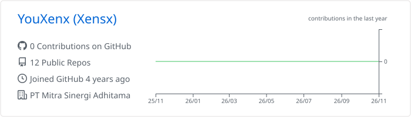
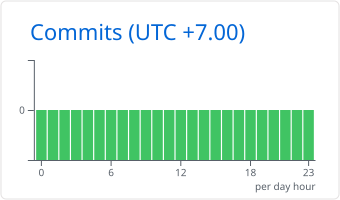
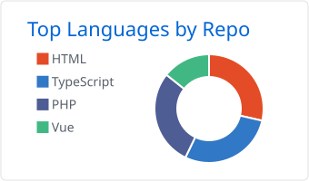
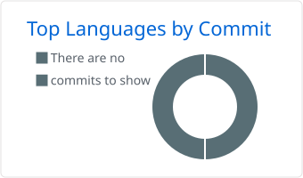
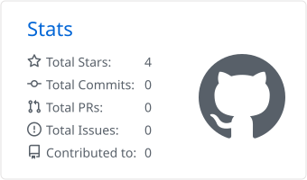

  

  

    
    
    
  

## 👨‍💻 About Me

I'm **Dimas Eka Priyadi**, a **Fullstack Web Developer** from Indonesia, currently at **PT Mitra Sinergi Adhitama**.
I enjoy turning ideas into fast, clean and easy-to-use web applications — from the database to the UI.

- 🔭 Building web apps with **Vue**, **Laravel** and **NestJS**
- 🧩 Love crafting **admin dashboards**, **REST APIs** and internal tools
- 🌱 Currently exploring **Go** for fast, simple backend services
- 🛡️ Interested in **web security** — knowing how things break helps me build them safer

## 🛡️ Red Team Mode

  
   
  Scope → recon → enumeration → reporting — always on <b>authorized</b> targets only.

## 🛠️ Tech Stack

<table>
  <tr>
    <td><b>Languages</b></td>
    <td>
      
      
      
      
      
      
      
    </td>
  </tr>
  <tr>
    <td><b>Frontend</b></td>
    <td>
      
      
      
      
      
      
    </td>
  </tr>
  <tr>
    <td><b>Backend</b></td>
    <td>
      
      
      
      
      
    </td>
  </tr>
  <tr>
    <td><b>Database</b></td>
    <td>
      
      
      
      
    </td>
  </tr>
  <tr>
    <td><b>Tools</b></td>
    <td>
      
      
      
      
      
      
    </td>
  </tr>
  <tr>
    <td><b>Security</b></td>
    <td>
      
      
    </td>
  </tr>
</table>

## 🚀 Featured Projects

| Project | Description | Stack |
| --- | --- | --- |
| [**Absensi PKM**](https://github.com/YouXenx/project-absensi-pkm-260926) | Web app to manage and monitor student attendance data in one central place. |  |
| [**Laravel 12 Playground**](https://github.com/YouXenx/laravel-12-test) | Personal project exploring the latest Laravel 12 features. |  |
| [**NestJS 11 Playground**](https://github.com/YouXenx/nestjs-11-test) | Backend experiments with NestJS 11 and TypeScript. |   |
| [**Vue.js Masterclass 2024**](https://github.com/YouXenx/vuejs-masterclass-2024-edition) | Course project built step by step with Vue 3. |  |

## 📊 GitHub Stats & Activity

  <picture><source media="(prefers-color-scheme: dark)" srcset="https://github-readme-stats.vercel.app/api?username=YouXenx&show_icons=true&include_all_commits=false&custom_title=Dimas%20Eka%20Priyadi%27s%20Stats&border_radius=12&bg_color=161b22&title_color=845adf&text_color=c9d1d9&icon_color=845adf&ring_color=845adf&border_color=30363d" /></picture>
  <picture><source media="(prefers-color-scheme: dark)" srcset="https://github-readme-stats.vercel.app/api/top-langs/?username=YouXenx&layout=compact&langs_count=8&card_width=280&border_radius=12&bg_color=161b22&title_color=845adf&text_color=c9d1d9&border_color=30363d" /></picture>
  <picture><source media="(prefers-color-scheme: dark)" srcset="https://streak-stats.demolab.com?user=YouXenx&card_width=360&card_height=195&border_radius=12&background=161b22&border=30363d&stroke=30363d&ring=845adf&fire=845adf&currStreakNum=c9d1d9&sideNums=c9d1d9&currStreakLabel=845adf&sideLabels=8b949e&dates=8b949e" /></picture>

  <picture><source media="(prefers-color-scheme: dark)" srcset="https://github-readme-activity-graph.vercel.app/graph?username=YouXenx&custom_title=Dimas%20Eka%20Priyadi%27s%20Contribution%20Graph&radius=12&height=240&area=true&bg_color=161b22&color=8b949e&line=845adf&point=c9d1d9&area_color=845adf&title_color=845adf&hide_border=false&border_color=30363d" /></picture>

  <picture><source media="(prefers-color-scheme: dark)" srcset="./profile-summary-card-output/github_dark/0-profile-details.svg" /></picture>
  <picture><source media="(prefers-color-scheme: dark)" srcset="./profile-summary-card-output/github_dark/4-productive-time.svg" /></picture>
  <picture><source media="(prefers-color-scheme: dark)" srcset="./profile-summary-card-output/github_dark/1-repos-per-language.svg" /></picture>
  <picture><source media="(prefers-color-scheme: dark)" srcset="./profile-summary-card-output/github_dark/2-most-commit-language.svg" /></picture>
  <picture><source media="(prefers-color-scheme: dark)" srcset="./profile-summary-card-output/github_dark/3-stats.svg" /></picture>

