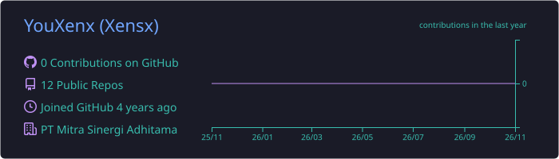
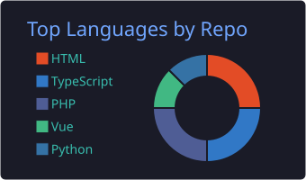
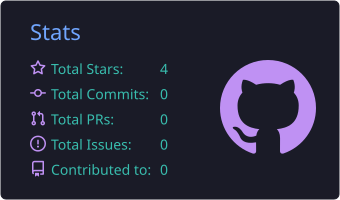
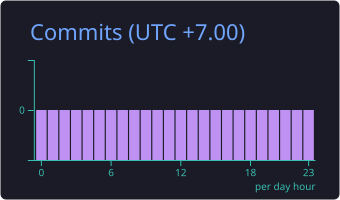

  

  

    
    
    
  

## 👨‍💻 About Me

I'm **Dimas**, a **Fullstack Web Developer** from Indonesia, currently at **PT Mitra Sinergi Adhitama**.
I enjoy turning ideas into fast, clean and easy-to-use web applications — from the database to the UI.

- 🔭 Building web apps with **Vue**, **Laravel** and **NestJS**
- 🧩 Love crafting **admin dashboards**, **REST APIs** and internal tools
- 🌱 Currently exploring **Go** for fast, simple backend services
- 🛡️ Interested in **web security** — knowing how things break helps me build them safer

## 🛠️ Tech Stack

<table>
  <tr>
    <td><b>Frontend</b></td>
    <td></td>
  </tr>
  <tr>
    <td><b>Backend</b></td>
    <td></td>
  </tr>
  <tr>
    <td><b>Database &amp; Tools</b></td>
    <td></td>
  </tr>
</table>

## 🚀 Featured Projects

| Project | Description | Stack |
| --- | --- | --- |
| [**Absensi PKM**](https://github.com/YouXenx/project-absensi-pkm-260926) | Web app to manage and monitor student attendance data in one central place. |  |
| [**Laravel 12 Playground**](https://github.com/YouXenx/laravel-12-test) | Personal project exploring the latest Laravel 12 features. |  |
| [**NestJS 11 Playground**](https://github.com/YouXenx/nestjs-11-test) | Backend experiments with NestJS 11 and TypeScript. |   |
| [**Vue.js Masterclass 2024**](https://github.com/YouXenx/vuejs-masterclass-2024-edition) | Course project built step by step with Vue 3. |  |

## 📊 GitHub Stats

  
  

  

### 📈 Contribution Activity

### 🧾 Profile Summary

  
  
  
  
  

Cards are regenerated every day by a GitHub Action.

### 🐍 Contribution Snake

<picture>
  <source media="(prefers-color-scheme: dark)" srcset="https://raw.githubusercontent.com/YouXenx/YouXenx/output/github-snake-dark.svg" />
  <source media="(prefers-color-scheme: light)" srcset="https://raw.githubusercontent.com/YouXenx/YouXenx/output/github-snake.svg" />
  
</picture>
